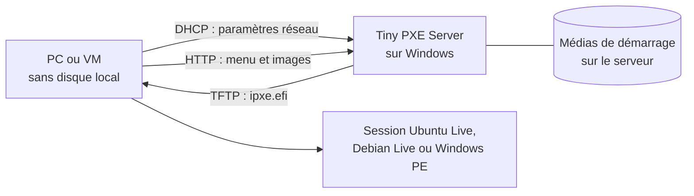
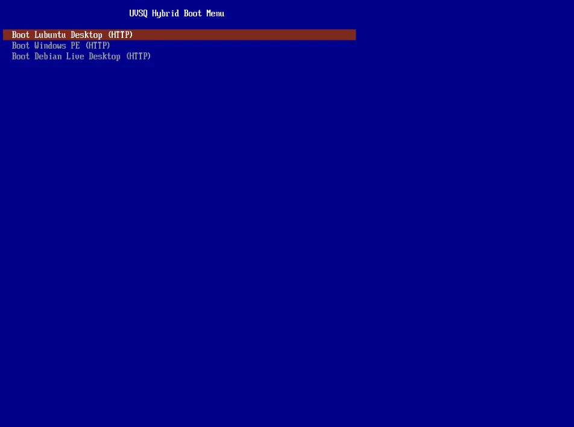
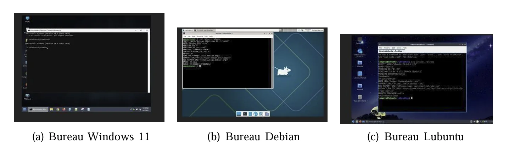

# iPXE triple-boot sans disque — Ubuntu, Debian et Windows PE

**Projet universitaire UVSQ — Ingénierie des Réseaux et des Systèmes, 2025–2026**

Ce projet permet de **démarrer trois environnements via le réseau**, sur des ordinateurs ou des machines virtuelles sans disque dur local : **Ubuntu Live, Debian Live et Windows PE**. Les fichiers de démarrage sont servis par une infrastructure commune ; aucune installation d'OS sur le disque des clients n'est requise.

> **Résultats des essais rapportés par l'équipe :** première validation sur **6 PC physiques**, puis extension à **plus de 20 postes** ; démarrage également réussi sur plusieurs VM sans disque dur virtuel. Les sessions étaient utilisables et permettaient d'exécuter des applications. Les captures des environnements et des essais réseau sont disponibles dans [la galerie du dépôt](#captures-des-essais) ; elles ne permettent cependant pas de vérifier indépendamment le nombre total de postes.

## Pourquoi ce projet ?

L'objectif est de proposer plusieurs environnements système depuis un serveur central, sans installer un OS individuellement sur chaque poste. Ce laboratoire explore les protocoles de démarrage réseau, l'administration centralisée et l'utilisation temporaire d'environnements Linux et Windows PE.

## Architecture



1. Le client UEFI demande une configuration réseau au serveur **DHCP**.
2. Il récupère `ipxe.efi` via **TFTP**.
3. Le menu iPXE propose Ubuntu Live, Debian Live et Windows PE.
4. Le client télécharge les composants nécessaires depuis le serveur par **HTTP**.
5. Le système choisi démarre sans disque local sur le client.

Le menu utilise `${dhcp-server}` pour construire les URLs HTTP. Cela suppose que l'adresse annoncée par DHCP correspond au serveur qui héberge les fichiers de démarrage. **Adapter cette valeur** lorsque DHCP et HTTP se trouvent sur des machines différentes.

[Architecture et choix techniques](docs/architecture.md)

## Résultats rapportés de l'expérimentation

| Essai | Résultat rapporté |
| --- | --- |
| Six postes physiques (phase initiale) | Démarrage réussi |
| Plus de vingt postes physiques (phase étendue) | Démarrage réussi |
| VM sans disque dur virtuel | Démarrage réussi |
| Ubuntu Live | Session utilisable |
| Debian Live | Session utilisable |
| Windows PE | Environnement utilisable |
| Exécution d'applications | Réalisée dans les environnements |

Les démarrages ont été décrits comme **rapides et stables, sans problème bloquant constaté pendant les essais**, mais **aucune durée de démarrage ni comparaison avec une moyenne de référence n'a été mesurée**. Les environnements utilisent la mémoire du client et des données hébergées sur le serveur, selon le média démarré. L'entrée « Windows » correspond à **Windows PE**, environnement de préinstallation/maintenance : elle ne démarre **pas une installation complète de Windows**.

Le responsable de la formation IRS a évoqué une **possible utilisation future** dans les laboratoires. Ce n'est pas une installation institutionnelle déjà effectuée ou officiellement validée.

[Scénarios de validation et limites](docs/validation.md)

## Rôle personnel et répartition du travail

Ce projet a été réalisé **en équipe** dans le cadre de la formation IRS. **Mon rôle personnel** portait principalement sur **la partie Windows/Windows PE et la gestion de la partie serveur** lors de la mise en place et des essais. Le déploiement et la validation sur les postes ont été réalisés dans le cadre du travail collectif.

Cette précision distingue les tâches prises en charge personnellement des résultats obtenus par toute l'équipe.

## Captures des essais

Cinq captures authentiques provenant du travail universitaire ont été fournies pour documenter :

- le menu « UVSQ Hybrid Boot Menu » (Lubuntu, Windows PE, Debian Live) ;
- l'ouverture des bureaux Linux et de l'environnement Windows PE ;
- les communications entre clients dans VirtualBox ;
- un ping depuis Windows PE vers le serveur ;
- un ping depuis Lubuntu vers le serveur.

Les cinq captures du laboratoire sont maintenant publiées dans [docs/screenshots](docs/screenshots/). Elles illustrent le menu, les environnements utilisables et les tests de connectivité :

| Menu réseau | Environnements démarrés |
| --- | --- |
|  |  |

| Communications entre clients | Test sous Windows PE | Test sous Lubuntu |
| --- | --- | --- |
| [Voir la capture des pings entre clients](docs/screenshots/03-tests-ping-entre-clients.webp) | [Voir le ping Windows PE](docs/screenshots/04-test-ping-windows-pe.webp) | [Voir le ping Lubuntu](docs/screenshots/05-test-ping-lubuntu-serveur.webp) |

Les tests `ping` visibles affichent **0 % de perte sur les échanges présentés** ; cela ne prouve pas que tous les démarrages ont été simultanés ou qu'une performance chiffrée a été mesurée.

[Observations détaillées et limites des captures](docs/observations-visuelles.md)

**Différence entre versions :** le menu photographié affiche **Lubuntu**, tandis que le fichier `menu.ipxe` actuellement publié utilise le libellé **Ubuntu Live**. La capture ne prouve donc pas qu'il s'agit de la version exacte de ce fichier. De même, une légende historique mentionne « Windows 11 », mais le terminal `X:\\Windows\\System32` visible sur la capture est cohérent avec l'utilisation de **Windows PE**.

## Contenu du dépôt

```text
.
├── README.md
├── .gitignore
├── config.ini
├── menu.ipxe
├── docs/
│   ├── architecture.md
│   ├── installation.md
│   ├── validation.md
│   ├── observations-visuelles.md
│   └── screenshots/
│       ├── README.md
│       └── 5 captures WebP
└── tests/
    └── test_configuration.py
```

**Important :** les fichiers ISO, noyaux, initrds, médias Windows PE, exécutables et chargeurs EFI ne sont **pas publiés** dans le dépôt : ils sont exclus par `.gitignore`. Les chemins du menu désignent des fichiers à placer **sur le serveur** et non des éléments déjà disponibles sur GitHub.

## Préparation

- Un hôte Windows avec Tiny PXE Server.
- Un réseau de laboratoire **isolé**, sans conflit avec un DHCP existant.
- Un ou plusieurs clients PXE/UEFI, physiques ou virtuels.
- Des médias Linux/Windows PE compatibles, préparés séparément, dans le respect des licences.

Le chemin `root=C:\studies\TER` de `config.ini` est **propre au laboratoire**. Il doit être remplacé par la racine réelle sur le serveur.

[Guide d'installation et de dépannage](docs/installation.md)

## Tests statiques

```bash
python -m unittest discover -s tests -v
```

Les **7 tests** inspectent la cohérence des références dans `config.ini` et `menu.ipxe`. Ils ne font **pas démarrer** d'OS et ne remplacent pas une validation sur du matériel réel.

## Limites

- Aucun système n'est installé de manière persistante sur un disque local par le menu publié.
- Le fonctionnement dépend des médias, du réseau et de la disponibilité du serveur.
- Secure Boot peut nécessiter une chaîne adaptée et signée.
- Les médias ne sont pas redistribués ici ; les licences restent applicables.
- Les mesures de performance et les journaux d'essais ne sont pas publiés. Cinq captures des environnements et de la connectivité sont disponibles dans `docs/screenshots/`.
- Toute adoption future en laboratoire demanderait des validations de sécurité, de compatibilité et d'exploitation.

Ce dépôt documente une **expérimentation universitaire**, pas une solution de production prête à déployer.
