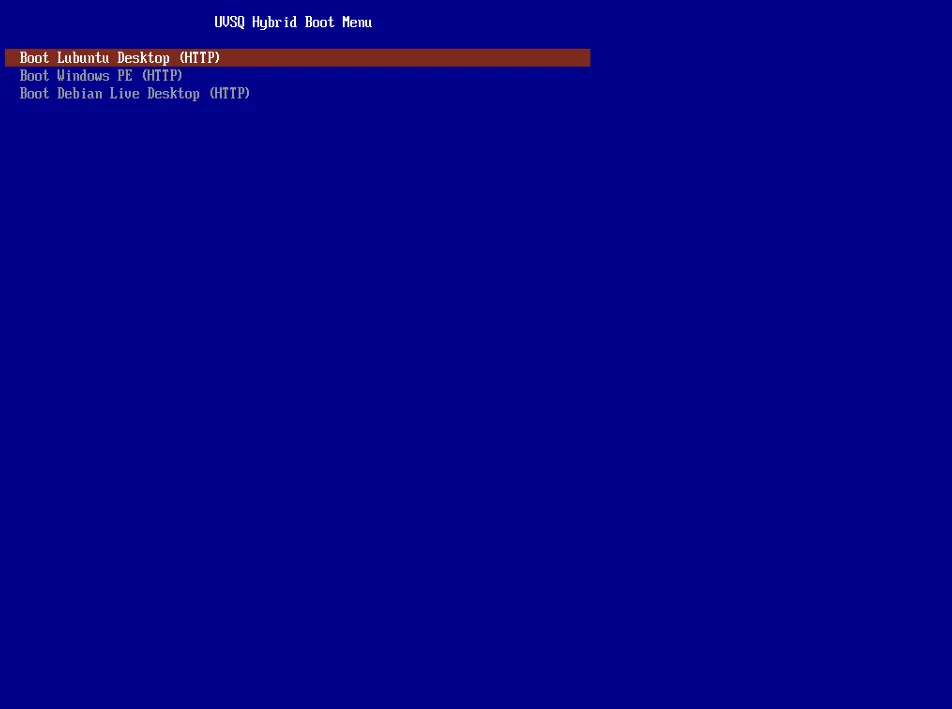
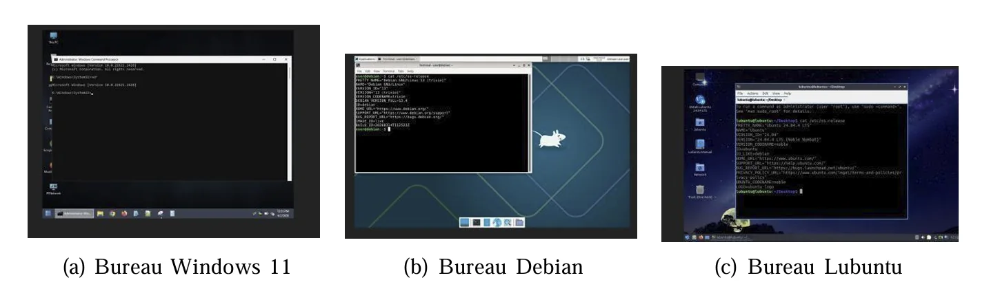

# Captures authentiques du projet iPXE

Ces images proviennent des essais universitaires transmis par l'équipe.

- `01-menu-ipxe.webp` : menu UVSQ Hybrid Boot avec Lubuntu, Windows PE et Debian Live.
- `02-environnements-winpe-debian-lubuntu.webp` : environnements démarrés. La légende de la capture historique parle de Windows 11, mais le terminal sur `X:\` correspond à l'environnement Windows PE.
- `03-tests-ping-entre-clients.webp` : communications entre machines virtuelles sous VirtualBox.
- `04-test-ping-windows-pe.webp` : configuration IP et ping depuis Windows PE.
- `05-test-ping-lubuntu-serveur.webp` : adressage et ping depuis Lubuntu.

## Aperçu

Les captures attestent les états et échanges visibles, mais ne prouvent pas à elles seules le nombre total de postes ni des performances chronométrées.
Le menu photographié utilise Lubuntu, tandis que le menu textuel actuellement publié dans `menu.ipxe` contient l'intitulé Ubuntu Live. Il peut donc s'agir de versions différentes.
